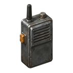

# PTT Radio

Push-to-talk voice radio for Factorio 2.1 multiplayer. You hold a key and talk, and the other players hear you. A list at the left edge of the screen shows who is talking, in their player colour. The voice travels through the multiplayer game itself, or over direct UDP between players when their networks allow it.

Factorio mods cannot use the microphone or the speakers, so the radio has two parts:

- **the mod**, `ptt-radio`, which is required on the server and on every client;
- **the companion**, a small program that every player runs next to the game. It records the microphone, plays the voices and talks to the mod over the game's Lua UDP port.

Only players who run their own companion can talk and hear voices. Everyone else still sees who is speaking.

[Русская версия ниже](#быстрый-старт).

## Download

Everything is on the [releases page](https://github.com/vshuraeff/ptt-radio/releases). `<ver>` is the release version, for example `0.4.0`.

| File | What it is |
| --- | --- |
| `ptt-radio_<ver>.zip` | the mod |
| `ptt-radio-companion-<ver>-windows-x86_64.zip` | companion for Windows |
| `ptt-radio-companion-<ver>-macos-universal.zip` | companion for macOS (Apple silicon and Intel) |
| `ptt-radio-companion-<ver>-linux-x86_64.tar.gz` | companion for Linux |
| `ptt-radio-hub-<ver>-linux-x86_64.tar.gz`, `ptt-radio-hub-<ver>-linux-aarch64.tar.gz` | optional relay hub for the game server |
| `SHA256SUMS` | checksums of all the files above |

The hub is also published as a container image, `ghcr.io/vshuraeff/ptt-radio-hub`.

## Quick start

1. Install the mod. Put `ptt-radio_<ver>.zip` into your Factorio `mods` folder, or install PTT Radio from the mod portal. The server needs it too.
2. Launch Factorio with the Lua UDP port open: add `--enable-lua-udp 34556` to the launch options. In Steam: right-click Factorio, then Properties, then Launch options.
3. Unpack the companion for your system and start `ptt-radio-companion` from a terminal. With no arguments it uses port 34556 for the game and listens on 34555, which is the mod's default. On macOS, allow microphone access when asked.
4. Join the game. The chat shows "Radio: companion connected."
5. Hold **F8** to talk, or press **ALT + V** to toggle the open microphone.

If the chat says "Radio: no companion", the companion is not running or the game was started without `--enable-lua-udp`. The mod cannot tell these two apart. See [Troubleshooting](https://github.com/vshuraeff/ptt-radio/wiki/Troubleshooting).

Server admins: the headless server also needs `--enable-lua-udp`. The [Server Setup](https://github.com/vshuraeff/ptt-radio/wiki/Server-Setup) and [Hub](https://github.com/vshuraeff/ptt-radio/wiki/Hub) pages cover it.

## Controls

| Action | Default |
| --- | --- |
| Push to talk (a global key, held in the companion) | `F8`, change it with `--ptt-key` |
| Open microphone on or off | `ALT + V`, or the radio button on the shortcut bar |
| Radio settings window | `ALT + SHIFT + V`, or the radio-and-cog button on the shortcut bar |
| Next channel preset | not assigned, bind "Cycle radio presets" in the controls |

The settings window picks your transmit channel and the channels you listen to, holds up to 8 presets, and has a switch that turns the radio off completely. By default everyone talks on the shared `ANY` channel. Administrators also get a policy section there and the `/radio-admin` command, see [Channels and Admin](https://github.com/vshuraeff/ptt-radio/wiki/Channels-and-Admin).

## Good to know

- **Half-duplex is on by default.** While you hold the push-to-talk key, other voices go quiet, so your speakers do not feed back into your microphone. With headphones you can turn it off in the mod settings.
- **Echo warning.** If the companion hears your speakers in your microphone, your line in the speaker list says "echo" and you get a button to turn off the open microphone. Headphones fix it.
- **Channels are not private.** They separate listeners only among honest clients. The server and a modified client can hear every channel.
- **A paused game pauses the voice** that goes through the game. Autosaves do too.
- **The companion keeps itself up to date.** Release builds check the latest GitHub release at every start, install it after verifying its checksum, and restart. Turn it off with `--no-self-update` or `PTT_RADIO_NO_SELF_UPDATE=1`.
- **Linux:** the push-to-talk key needs an X11 session. A pure Wayland session has no global key for the companion yet.

## Documentation

The [wiki](https://github.com/vshuraeff/ptt-radio/wiki) has the full guides in English and Russian:

| English | Русский |
| --- | --- |
| [Installation](https://github.com/vshuraeff/ptt-radio/wiki/Installation) | [Установка](https://github.com/vshuraeff/ptt-radio/wiki/RU-Installation) |
| [Companion](https://github.com/vshuraeff/ptt-radio/wiki/Companion) | [Компаньон](https://github.com/vshuraeff/ptt-radio/wiki/RU-Companion) |
| [Server Setup](https://github.com/vshuraeff/ptt-radio/wiki/Server-Setup) | [Настройка сервера](https://github.com/vshuraeff/ptt-radio/wiki/RU-Server-Setup) |
| [Hub](https://github.com/vshuraeff/ptt-radio/wiki/Hub) | [Хаб](https://github.com/vshuraeff/ptt-radio/wiki/RU-Hub) |
| [Channels and Admin](https://github.com/vshuraeff/ptt-radio/wiki/Channels-and-Admin) | [Каналы и администрирование](https://github.com/vshuraeff/ptt-radio/wiki/RU-Channels-and-Admin) |
| [Troubleshooting](https://github.com/vshuraeff/ptt-radio/wiki/Troubleshooting) | [Решение проблем](https://github.com/vshuraeff/ptt-radio/wiki/RU-Troubleshooting) |
| [Building from Source](https://github.com/vshuraeff/ptt-radio/wiki/Building-from-Source) | [Сборка из исходников](https://github.com/vshuraeff/ptt-radio/wiki/RU-Building-from-Source) |

## Быстрый старт

PTT Radio — рация с кнопкой «нажми и говори» для мультиплеера Factorio 2.1. Голос идёт через саму игру или напрямую по UDP между игроками. Слева на экране видно, кто сейчас говорит. Мод нужен на сервере и у каждого клиента. Кроме мода каждый игрок запускает компаньон — небольшую программу, которая работает с микрофоном и динамиками. Голоса слышат только те, у кого запущен свой компаньон.

1. Установите мод: положите `ptt-radio_<версия>.zip` со [страницы релизов](https://github.com/vshuraeff/ptt-radio/releases) в папку `mods` или установите PTT Radio с мод-портала. На сервере мод тоже нужен.
2. Запускайте Factorio с параметром `--enable-lua-udp 34556`. В Steam: правой кнопкой по Factorio, «Свойства», «Параметры запуска».
3. Распакуйте компаньон для своей системы и запустите `ptt-radio-companion` из терминала. Без аргументов он работает с игрой на порту 34556 и слушает порт 34555 — это значение по умолчанию в настройках мода. На macOS разрешите доступ к микрофону, когда система спросит.
4. Зайдите в игру. В чате появится «Рация: компаньон подключён».
5. Держите **F8**, чтобы говорить, или нажмите **ALT + V**, чтобы включить открытый микрофон.

Если в чате написано «Рация: компаньон не найден», значит, компаньон не запущен или игра запущена без `--enable-lua-udp`; мод не может отличить одно от другого. Настройки рации открываются клавишами `ALT + SHIFT + V`. Компаньон из релиза сам обновляется до последней версии при каждом запуске (отключается флагом `--no-self-update`). В Linux клавиша PTT работает только в сеансе X11.

Подробные инструкции на русском — в вики: [Установка](https://github.com/vshuraeff/ptt-radio/wiki/RU-Installation), [Решение проблем](https://github.com/vshuraeff/ptt-radio/wiki/RU-Troubleshooting).

## For developers

The design, the wire formats, the trust boundaries and the measurements are in [DESIGN.md](DESIGN.md) (in Russian, with English sections for the v2 transport contracts). Build instructions are on the wiki's [Building from Source](https://github.com/vshuraeff/ptt-radio/wiki/Building-from-Source) page.

- `mod/ptt-radio/` is the mod (Lua), `mod/tests/` its tests, which run without Factorio.
- `companion/` is the Rust crate with three binaries: the companion `ptt-radio-companion`, the relay hub `ptt-radio-hub` and the `relay` game emulator for end-to-end tests. Building needs Rust, cmake and a C compiler; libopus is built from source and linked statically.
- `tools/gate.sh [--twice] [log dir]` is the full acceptance gate: `cargo fmt --check`, clippy, the debug and release test suites, the real-time voice scenarios, `aec_gate`, `luac -p` and the four Lua suites. It needs `cargo`, `flock`, `lua` and `luac` on `PATH`; on macOS `flock` comes from Homebrew. Real-time steps hold a shared lock file (`PTT_REALTIME_LOCK`, wait limit `PTT_REALTIME_WAIT`) so two runs on one machine do not measure at once, and a real-time test that fails is rerun once by name and reported as flaky if the rerun passes.
- The Lua checks alone, from this directory: `luac -p mod/ptt-radio/*.lua mod/tests/*.lua`, then `lua mod/tests/<name>_test.lua mod/ptt-radio/control.lua` for `control`, `channels`, `admin` and `settings_gui`.
- `tools/radio.py` emulates a companion without audio: `uv run -q tools/radio.py {hello|talk|listen}`; `talk --no-stop` imitates a crashed companion.
- `stand/` runs a headless 2.1 server with the mod in Docker, optionally with the hub beside it (`compose.hub.yaml`). The live acceptance checklist is `stand/ACCEPTANCE.md`. `client-mods/` is a mod directory for a test client (`--mod-directory`), so your main installation stays untouched.

### Measured so far

Recorded on 2026-10-24 on one macOS machine with the headless server in a local container. These are the current numbers, not a passed quality acceptance.

- Through the game on the stand: frame round trip p50 75–77 ms, p95 87 ms or less; STOP 76–84 ms after the key is released. A companion that dies mid-phrase is closed by the mod 587 ms after its last frame.
- Mouth-to-ear in the network model, by route: game 153 ms, direct 65 ms, hub 95 ms, player relay 85 ms, game fallback 154 ms. After the direct path is cut mid-phrase, the gap is 30 ms when it falls back to the hub and 70 ms to the game; after the hub fails, 50 ms.
- Double-talk through the hub is a known flaky case: the other player's voice measured from −4.2 to −2.4 dB against a −4 dB threshold, 6 passes and 5 failures out of 11 known runs.
- Warmed-up echo cancellation keeps your own returned voice below −50 dB, but in a three-way conversation the 1–4 kHz band lost up to 12.1 dB, and before the echo is detected on a cold start the return is audible.
- Not yet checked live: the push-to-talk key with the Factorio window focused, real speakers, and the macOS permission prompts.

The tables and the conditions behind these numbers are in [DESIGN.md](DESIGN.md#network-lab).

## License

GPL-3.0-only. See [LICENSE](LICENSE).
